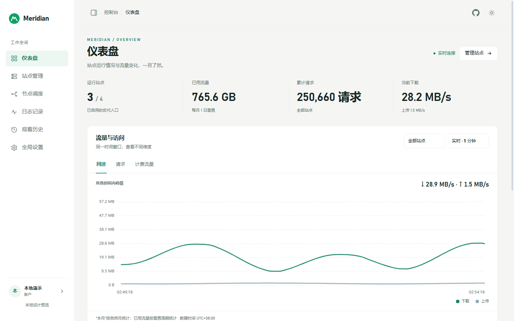
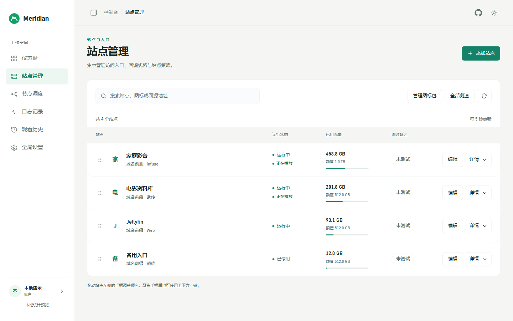
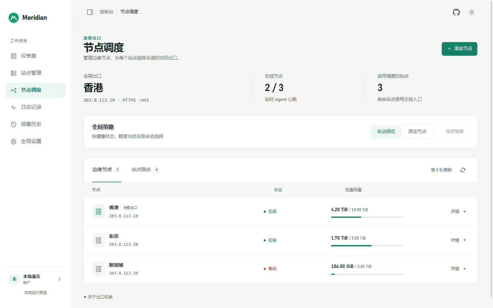
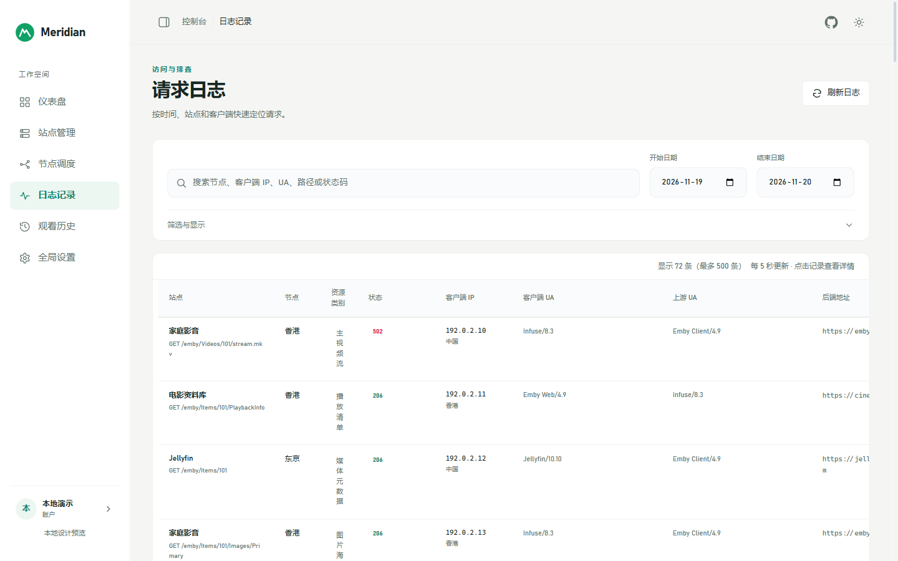
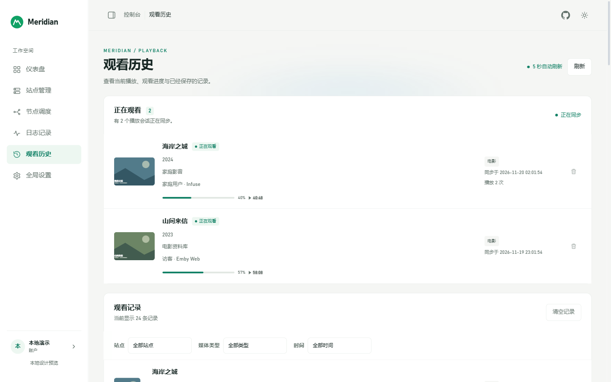
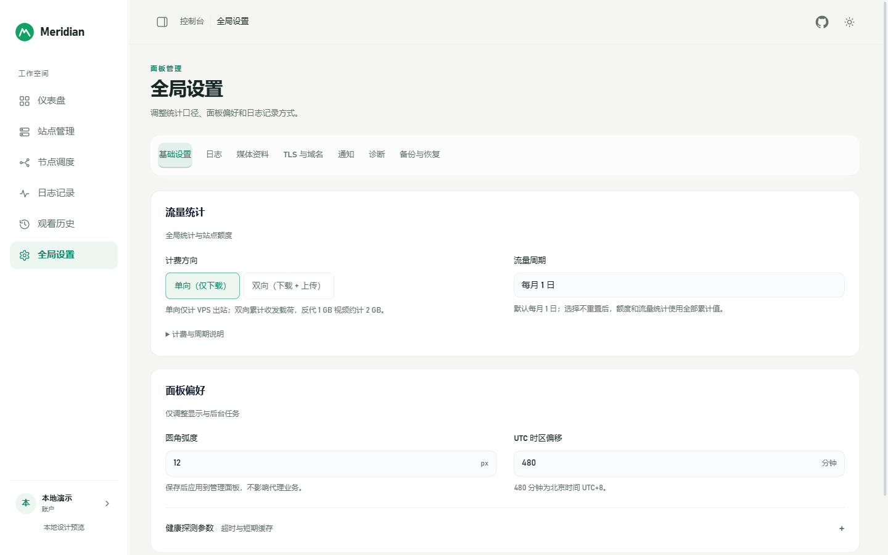
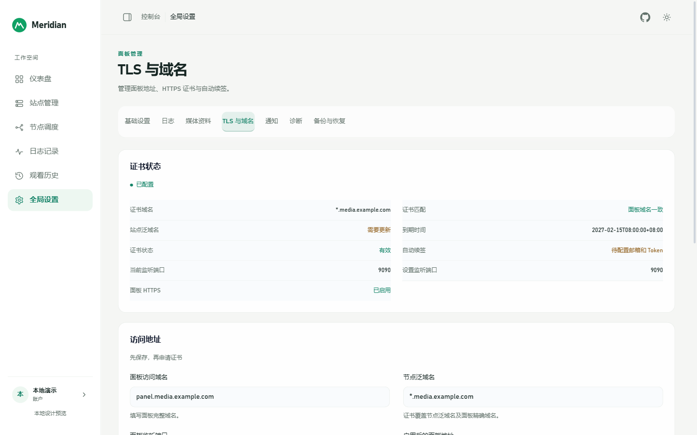
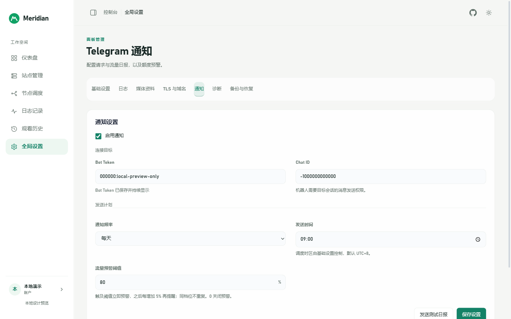
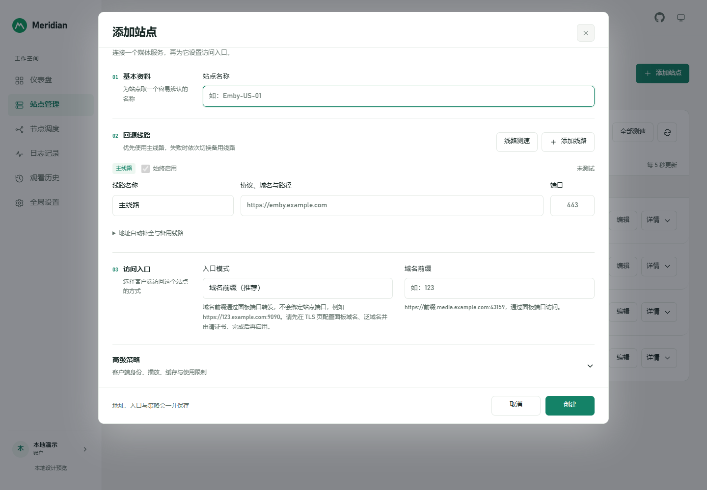

<p align="center"></p>

# Meridian

[](https://github.com/chanhui800/Meridian/actions/workflows/ci.yml)
[](https://github.com/chanhui800/Meridian/releases/latest)
[](LICENSE)
[](https://emby.fydivine.com)

Meridian 是面向 Emby 和 Jellyfin 的多站点反向代理与节点调度面板。它把站点入口、备用线路、播放地址改写、流量统计、请求日志、观看历史、TLS 和可选的边缘 Agent 放在一个控制面板里。

正式安装版本和校验文件以 [最新 GitHub Release](https://github.com/chanhui800/Meridian/releases/latest) 为准。本文描述当前主分支；尚未发布的改动会随后续正式版本提供。节点调度按站点启用，未启用的站点继续使用原面板入口。

## 界面预览

下面的截图只用于展示界面布局，使用的是演示数据。截图中没有生产环境的域名、IP、令牌或证书。

| 仪表盘 | 站点管理 |
| --- | --- |
|  |  |
| 节点调度 | 请求日志 |
|  |  |
| 观看历史 | 全局设置 |
|  |  |
| TLS 设置 | Telegram 日报 |
|  |  |

<details>
<summary>查看添加站点弹窗</summary>



</details>

示例图片保存在 [`docs/images`](docs/images/)。更新文档时请保留这些文件和上面的引用。

## 功能

- 管理多个站点和上游线路，支持主线路、备用线路和自动故障切换。
- 支持独立端口、路径前缀和域名前缀三种入口方式。
- 改写 PlaybackInfo、HLS、DASH、HTTP 重定向、字幕、图片和 WebSocket 地址。
- 主视频流可以反代，也可以在上游返回合法公网 30x 时让客户端直连 CDN。
- 记录请求、最终后端、客户端信息、收发字节和趋势。
- 请求详情显示每次回源的连接、响应头与首字节耗时，以及缓存命中或跳过原因；实时日志更新保留当前阅读位置。
- 实时趋势由 Controller 统一采样，支持缺报区间回填和历史点修订；速度保留真实峰值，流量与请求保持累计口径。
- 可选观看历史、媒体库数量、保号提醒、TMDB 补全和 Telegram 日报。
- 站点列表直接显示回源延迟，点击延迟结果即可重新测速，无需单独的测速按钮。
- 点击站点行展开或收起详情，拖拽手柄在鼠标悬浮时显示；添加站点与故障诊断沿用统一布局。
- 客户端 UA 默认透传，不内置伪装 UA；需要时可给站点指定自定义 UA。
- 添加站点时自动识别 `https` 和端口，地址不完整时自动补全。
- 支持 ACME DNS-01、自动续签、加密备份与恢复。
- 可选节点调度：一个 Controller 管理多台 Linux Agent，DNS 只切换新连接。
- 主控模式按站点启用：关闭时保留原面板入口；启用时可跟随全局调度或固定到指定节点。
- Agent 地址族可按节点能力发布：V4 节点发布 A，V6 节点发布 AAAA，双栈节点默认同时发布 A/AAAA，也可在节点级手动只发布其中一个。
- 注册和完整上报会自动填入可确认的公网 IPv4/IPv6，兼容已有节点的空地址字段，并保留已填写的手工地址；没有可用 IPv6 时保持为空。
- Agent 支持 Linux amd64/arm64，安装器从当前主控获取并校验匹配版本的二进制；Controller 不需要把 Agent 打进镜像。
- 默认内置离歌、Sakura、良友三个图标包，支持从来源链接刷新、自定义包导入，以及在站点图标选择弹窗内直接切换图标包。

## 快速安装

### Docker

```yaml
services:
  meridian:
    image: ghcr.io/chanhui800/meridian:latest
    container_name: meridian
    restart: unless-stopped
    network_mode: host
    volumes:
      - ./data:/app/data
    environment:
      PORT: "9090"
      DB_PATH: /app/data/meridian.db
```

```bash
mkdir -p data
docker compose up -d
docker compose logs -f meridian
```

首次启动时日志会输出一次管理员初始化令牌。打开 `http://服务器地址:9090` 完成初始化。数据库、TLS 状态和缓存位于 `./data`，更新容器不会删除它们。`network_mode: host` 会让面板和站点端口直接使用宿主机网络，请先确认端口没有被其他服务占用。

生产环境可以把 `latest` 换成固定版本。固定版本便于回滚和排查问题。

### Linux 原生安装

启动交互式管理菜单（安装、更新、修改密码、卸载和删除数据）：

```bash
curl -fsSL \
  https://github.com/chanhui800/Meridian/releases/latest/download/install.sh \
  | sudo bash
```

安装器会自动获取最新正式 Release，并校验实际下载的程序。需要固定版本或在高安全环境中安装时，再使用固定 Release 的校验流程；不要从可变的 `main` 分支直接执行安装脚本。

菜单中的卸载选项默认保留数据库、TLS 状态和备份；选择“卸载并删除数据”才会删除 Meridian 数据目录。自动化部署仍可使用参数：

```bash
curl -fsSL https://github.com/chanhui800/Meridian/releases/latest/download/install.sh | sudo bash -s -- install -y --no-domain
# 卸载但保留数据
curl -fsSL https://github.com/chanhui800/Meridian/releases/latest/download/install.sh | sudo bash -s -- uninstall -y
# 卸载并删除数据
curl -fsSL https://github.com/chanhui800/Meridian/releases/latest/download/install.sh | sudo bash -s -- uninstall -y --purge
```

默认数据库为 `/var/lib/meridian/meridian.db`，服务名为 `meridian`：

```bash
sudo systemctl status meridian --no-pager
sudo journalctl -u meridian -f
```

安装器会按 CPU 架构下载并校验 GitHub Release 二进制。升级时重新运行安装器，数据库、TLS 状态和缓存会保留。

## 站点管理

新增站点时填写站点名称、入口方式和上游线路。入口示例：

| 方式 | 示例 |
| --- | --- |
| 独立端口 | `http://panel.example.com:9001` |
| 路径前缀 | `https://panel.example.com:9090/movie` |
| 域名前缀 | `https://movie.example.com:9090` |

每个站点可以配置一条主线路和最多七条备用线路。普通 API、HLS/DASH、字幕、图片和 WebSocket 默认反代。主视频流选择“直连”时，只有上游返回合法公网 30x 才会把连接交给客户端。

线路地址会自动补全协议，并把显式端口填入端口栏。例如 `media.example.com:80` 识别为 HTTP/80，`:443` 识别为 HTTPS/443。编辑已有线路的域名或路径时保留单独填写的端口；要更换端口，可以直接修改端口栏，或在地址中输入新的端口。客户端 UA 默认透传，需要固定 UA 时选择“自定义”。

添加和编辑站点使用统一的分组弹窗：基本资料、回源线路、访问入口依次填写，UA、播放、缓存、额度和固定请求头收在“高级策略”中。弹窗支持手机单列布局，保存与取消按钮固定在底部。

### 站点图标

Meridian 默认内置离歌 Emby、Sakura 圆形和良友媒体三个图标包的 JSON 快照，新安装即可选择使用。升级时会按来源链接补足缺少的默认包，已经导入的同源包和当前使用中的图标包会保留。图标包名称、说明和图片仍来自各自作者，来源链接在列表中完整显示：

- [离歌 Emby 图标包](https://raw.githubusercontent.com/lige47/lige_icon/main/lige-emby-icon.json)
- [Sakura 圆形图标包](https://raw.githubusercontent.com/baiitang/Sakura/main/Fileball/Yuan/tubiao.json)
- [良友媒体图标库](https://raw.githubusercontent.com/MaddestAlistar/LiangYou-IconLibrary/main/LiangYou-Emby-Icons.json)

打开“站点管理 → 管理图标包”，点击包旁的“刷新”即可从来源链接读取最新内容，更新同一个图标包。刷新不会新增重复包，也不会改变当前选择；读取或校验失败时会保留原内容。额外的图标包仍可填写公开的 HTTPS JSON 链接导入，名称和说明自动读取 `name` 和 `description`，无需手动填写。浏览器读取链接，服务器只校验和保存包内容，不会在服务器端抓取链接。

图标包格式如下：

```json
{
  "name": "我的图标包",
  "description": "可选说明",
  "icons": [
    { "name": "Emby", "url": "https://cdn.example.com/emby.png" },
    { "name": "Jellyfin", "url": "https://cdn.example.com/jellyfin.png" }
  ]
}
```

点击站点卡片或站点实时状态中的圆形图标后，可以在“设置站点图标”弹窗内直接下拉切换图标包、刷新当前包并按名称搜索，无需跳转到图标包管理。选择图标时才会修改站点图标；切换、刷新或删除图标包都会保留站点原来分配的图标。若要移除某个站点图标，在弹窗中选择“使用首字母”。删除默认包后，后续重启不会重复补回；需要时可通过其来源链接重新导入。

每个图标包大小上限为 4 MiB，最多 16384 个图标，支持 Sakura 和良友等大型图标库。图片地址必须是 HTTPS，名称不能包含换行或控制字符。

域名入口需要在“全局设置 → TLS 设置”中分别填写面板完整域名（例如 `panel.admin.example.com`）和节点泛域名（例如 `*.example.com`）。两者必须属于同一注册域但不能相同，现有站点域名无需迁移。Controller 证书会按配置覆盖面板域名，并在需要承载 Host 入口时包含节点泛域名；每台 Edge Agent 使用自己的证书和私钥，不共享 Controller 私钥。

## 节点调度与主控模式

节点调度是可选模块。Controller 保存节点、站点分配、优先级、流量周期、地址族和 DNS 状态；每台 VPS 只运行一个轻量 `meridian-agent`，不需要安装完整面板。详细步骤见：[节点调度](docs/node-scheduling.md) 和 [Agent 安装与卸载](docs/agent-installation.md)。

站点的调度开关在“主控模式”分组中逐站点设置：

- **节点调度未启用**：继续使用原面板入口，站点不会创建或切换 Agent DNS 记录。
- **跟随全局节点**：由 Controller 按优先级、心跳、配置状态和流量额度选择可用节点。
- **固定到指定节点**：只使用管理员选择的节点；节点不可用时保持等待，不会悄悄切换到其他节点。

节点保存独立的 IPv4 和 IPv6 地址。DNS 发布策略默认按节点地址能力工作：只有 IPv4 时发布 A，只有 IPv6 时发布 AAAA，同时拥有两者时发布 A 与 AAAA。需要兼容特定网络时，可以手动选择“仅 IPv4”或“仅 IPv6”；切换地址族时 Controller 只维护自己创建的对应记录，不会删除用户手工创建的同名记录。

调度过程如下：

```text
客户端 -> 站点域名 -> 精确 DNS A/AAAA -> Edge Agent -> 上游 Emby/Jellyfin
                                      ^
                                      |
                              Controller 配置与状态
```

站点启用调度后，Controller 会把路由、线路、播放改写和 TLS 配置下发给目标 Agent。Agent 应用配置并通过 HTTPS/SNI 健康检查后，Controller 才创建或更新自己管理的精确 DNS 记录。DNS 只影响新连接，已有播放连接不会被强制迁移。

自动模式会排除未启用、心跳超时、配置未应用或已达到流量额度的节点，再按优先级和周期用量选择节点。手动模式只使用管理员指定的节点；指定节点不可用时会保持等待，不会偷偷切到其他节点。停用或删除调度时，只删除 Meridian 自己保存的 DNS 记录 ID，不触碰用户手动创建的同名记录。

Agent 每 5 秒上报一次完整心跳、网卡累计收发字节、配置版本和监听错误；面板实时流量使用独立的 2 秒轻量采样。媒体库、观察记录、事件和完整站点状态仍随完整报告上报。Controller 会在报告写入前验证 Node → Site 授权，并对 HTTP、WebSocket 和实时采样使用同一套每节点速率与并发限制。一个被攻陷的 Agent 只能影响当前 `desired_node_id` 或 `applied_node_id` 范围内的站点。

完整报告负责持久化，轻量采样负责实时速度。Controller 按遥测顺序合并计数，迟到的报告不会使实时计数回退，完整报告也不会把仍有效的实时速度清空。短暂缺报后的流量增量按覆盖区间回填，并立即同步页面上已显示的旧点。

实时速度图按显示区间保留下载、上传峰值，短缺样使用有限衰减连接；流量和请求总量仍来自原始累计计数。速度摘要对应当前绘制序列，请求使用整数折线，最小纵轴范围为 0–5。

主控配置 Cloudflare ACME 凭据后，可以执行：

```bash
docker exec meridian /app/meridian admin issue-edge-certificate
```

该命令为已注册且启用的节点签发独立 Edge 证书。新节点注册后会进入证书任务队列，失败会按退避策略重试。证书缺失或配置尚未应用时，站点会保持等待状态，并在节点调度页面显示最近一次错误。

## 观看历史、TLS 和备份

观看历史的保留天数在“全局设置 → 媒体资料”中调整，范围为 1–3650 天。保存资料语言、Token 或补全开关时会保留当前天数；后台只按保存的保留期清理过期记录。

面板可以直接监听 HTTPS，也可以放在已有反向代理后面。使用 80 或 443 前，请先确认没有其他进程占用。

`TLS_STATE_DIR` 是 Meridian 唯一可以整体管理的 TLS 状态目录，默认位于数据库目录下的 `tls`。面板和边缘证书、ACME 账户、节点证书状态以及恢复事务文件都保存在这个目录。`PANEL_TLS_*` 和 `EDGE_TLS_*` 可以指向运维方管理的外部证书文件；包含 TLS 的备份恢复不会删除或替换这些外部文件。

备份页面生成带密码的 `.mrbak` 文件。新备份使用 `MRDBKP02` 分块加密格式，旧的 `MRDBKP01` 备份仍可读取。备份恢复会校验文件数量、展开大小、数据库 schema 版本、路径和证书密钥对；恢复失败时原数据库和 TLS 状态不会被部分覆盖。默认不包含 TLS，迁移面板域名或节点证书时再显式勾选。

安装器管理的 Nginx 为备份恢复请求设置 260 MiB 上限，为图标包导入和刷新请求设置 4160 KiB 上限，包含上传表单或 JSON 的额外空间；应用仍分别限制备份文件为 256 MiB、图标包为 4 MiB。普通请求保留 1 MiB 上限。更新时会迁移可识别的托管配置，保留 Certbot 的证书与 HTTPS 跳转；配置检查或重载失败会恢复原文件。

## 常用环境变量

| 变量 | 默认值 | 说明 |
| --- | --- | --- |
| `PANEL_BIND_ADDR` | `0.0.0.0` | 面板监听地址 |
| `PORT` | `9090` | 面板端口 |
| `DB_PATH` | `meridian.db` | SQLite 数据库路径 |
| `JWT_SECRET` | 自动生成 | 登录和敏感配置加密密钥 |
| `UPSTREAM_HEADER_KEY` | 自动生成 | 上游请求头密钥 |
| `DYNAMIC_ROUTE_KEY` | 自动生成 | 动态路由密钥 |
| `TRUSTED_PROXY_CIDRS` | `127.0.0.1/32,::1/128,10.0.0.0/8,172.16.0.0/12,192.168.0.0/16,fc00::/7` | 可信前置代理网段，默认包含回环、RFC1918 IPv4 私网和 IPv6 ULA |
| `PANEL_EXTERNAL_PROXY_ENABLED` | `false` | 外部反代是否已部署；已有反代承载 Host 入口时设置 `true`，并配置可信来源 |
| `ASSET_CACHE_DIR` | 数据库目录下 `asset-cache` | 图片缓存目录 |
| `TLS_STATE_DIR` | 数据库目录下 `tls` | Meridian 管理的 TLS 状态目录，必须使用绝对路径，并与数据库、恢复目录分开 |
| `PANEL_TLS_CERT_FILE` / `PANEL_TLS_KEY_FILE` | TLS 状态目录中的面板证书 | 可指定外部文件；恢复流程不会删除或替换 |
| `EDGE_TLS_CERT_FILE` / `EDGE_TLS_KEY_FILE` | TLS 状态目录中的边缘证书 | 可指定外部文件；节点证书状态仍保存在 `TLS_STATE_DIR` |
| `DNS_PROPAGATION_RESOLVERS` | 系统默认 resolver | 逗号分隔的 IPv4/IPv6 DNS resolver |
| `DNS_PROPAGATION_TIMEOUT` | `120s` | DNS-01 传播检查超时时间 |

`TRUSTED_PROXY_CIDRS` 未配置或留空时使用上述回环和私网范围，这些来源直达后端时可通过规范化的单值 `X-Real-IP` 和 `X-Forwarded-Proto` 提供真实客户端 IP 与 HTTPS 状态；非空自定义值会替换整个默认范围。实际前置代理应覆盖这两个请求头。公网、链路本地地址（`169.254.0.0/16`、`fe80::/10`）和 CGNAT（`100.64.0.0/10`）不在默认范围内，不要信任全网地址。

默认转发头信任范围不会启用 Host 入口。公网 HTTP 面板需要通过 `PANEL_EXTERNAL_PROXY_ENABLED=true` 明确声明已有反代，并在 `TRUSTED_PROXY_CIDRS` 中限制实际代理来源；请求仍会检查连接来源是否可信。回环监听和内置面板 TLS 也支持 Host 入口。新安装写入 `false`，安装器配置或取消面板反代时分别写入 `true` 或 `false`。旧配置未设置此变量时，仅全部由 `/32` 或 `/128` 单地址组成的可信列表保留原有反代判定；使用私网网段的已有反代需要显式设为 `true`。备份恢复使用同一部署状态判断，当前服务器不支持的 Host 入口会被清空并停用，站点数据仍会保留。

故障诊断、站点列表延迟和添加站点的线路测速均保留。诊断允许正常的本机、局域网与公网回源，拒绝云元数据和链路本地等特殊目标；DNS 解析结果校验后直接连接，不使用环境 HTTP 代理。添加站点的任意地址测试最多同时执行 4 个请求，允许 24 次突发、每秒恢复 1 次额度，超过限制时稍后重试。诊断不会转发管理登录凭据，日志只记录目标主机和测试结果。详细边界见[代码扫描复核](docs/code-scanning-review.md)。

## 升级和发布

正式版本、校验文件和变更说明见 [GitHub Releases](https://github.com/chanhui800/Meridian/releases)。固定版本镜像格式为 `ghcr.io/chanhui800/meridian:<版本号>`，`latest` 只指向最新成功的正式 Release。

v1.11.7 汇总了反代可靠性、缓存、观看记录、站点交互与性能优化，具体变化和升级说明见 [v1.11.7 发布说明](docs/releases/v1.11.7.md)。

升级 Controller 后，已注册 Agent 会通过受认证的配置和清单接口获取匹配版本的下载信息。正式版从固定 GitHub Release 下载，下载请求不携带 Controller 令牌；开发构建使用需要认证的 Controller 二进制接口。

Agent 在后台下载、校验平台和 SHA-256，期间继续应用配置和上报完整心跳。下载完成后确认目标版本和配置仍有效，再原子替换并由服务管理器重启。普通升级保留节点令牌和状态，不需要重新注册。只有节点令牌被主动刷新、状态文件丢失或节点更换 Controller 时，才需要运行面板生成的 `--reenroll` 安装命令。

Agent 事件队列使用有界的加密追加日志，必要的观看事件接收和 ACK 仍需持久化；普通事件批量写入以减少请求路径的磁盘开销。正常停止和自动更新会等待写入完成，并导出兼容旧版的队列。降级时应先正常停止 Agent；队列导出失败会阻止程序替换，积压超过旧格式上限时需先恢复上报并等待队列消化。

原生 Controller 安装器会保留更新前的程序和数据，用于失败回滚。启用捆绑 Agent 二进制时，部分替换失败也会恢复已替换的程序，避免留下混合版本。

Windows 和 macOS 构建产物目前用于开发和测试；生产部署支持 Linux Controller 与 Linux amd64/arm64 Agent。

## 开发检查

使用 `go.mod` 指定的 Go 工具链或更新的受支持版本；当前最低版本为 Go 1.26.11。与 GitHub CI 一致的基本检查：

```bash
go mod verify
go test ./...
go test -race -timeout=20m ./...
go vet ./...
GOOS=windows GOARCH=amd64 go vet ./...
GOOS=darwin GOARCH=arm64 go vet ./...
find web/static/js -name '*.js' -print0 | xargs -0 -n1 node --check
node --test tests/*.test.js
bash -n install.sh
bash -n scripts/agent-install.sh
bash -n docker-entrypoint.sh
```

CI 另执行漏洞扫描、静态安全检查、安装器回归和 Docker 构建。

CodeQL 在上传结果后检查未经审阅的严重和高危告警；正式发布还会核对当前精确提交的主分支扫描结果。已验证的误报和范围明确的例外按具体指纹、保护代码摘要和有效期记录，不能按整条规则忽略。修改相关保护措施后需要重新复核，扫描任务执行成功不等于零告警。

Fuzz 每次针对根包中的单个目标运行，例如：

```bash
go test -run '^$' -fuzz '^FuzzNormalizeDynamicURL$' -fuzztime 60s .
```

项目许可证见 [LICENSE](LICENSE)，安全问题请按 [SECURITY.md](SECURITY.md) 的方式私下报告。
