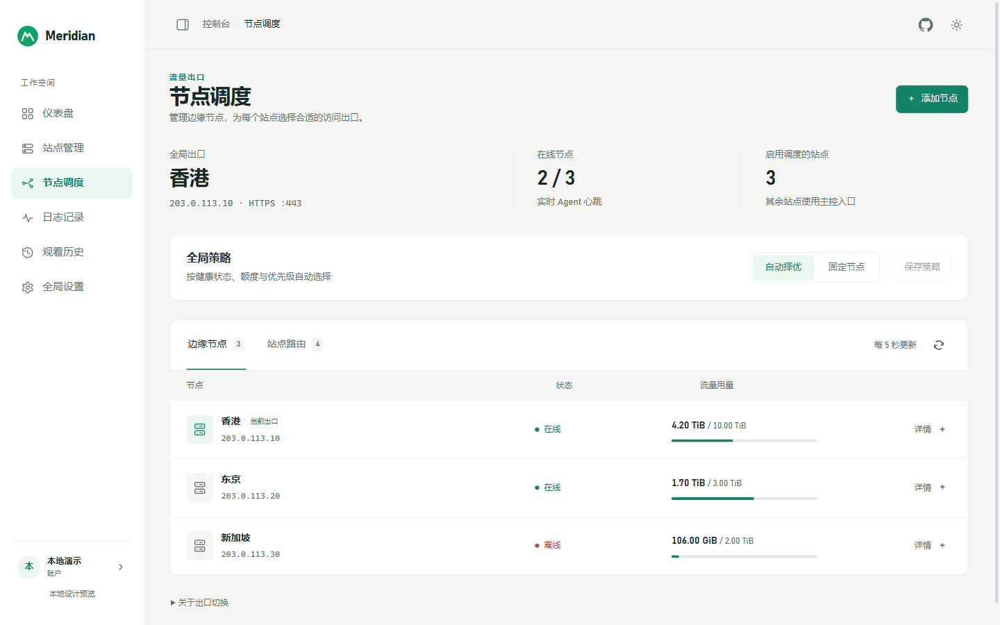

# 节点调度

节点调度是 Meridian 的可选分布式入口模块。Controller 保存节点、站点分配、优先级、流量周期和 DNS 状态；每台 VPS 只运行一个轻量 `meridian-agent`，负责 HTTPS 监听、站点反代、网卡流量采集和状态上报。



> 图片只用于说明页面布局，节点地址、站点域名和统计数据均为虚构示例。

## 工作方式

```text
客户端 -> 站点域名 -> 精确 DNS A/AAAA -> 节点 Agent -> 站点上游 Emby/Jellyfin
                                      ^
                                      |
                              Controller 配置与状态
```

- 未启用调度的站点继续使用主控入口，不会改变现有 DNS。
- 启用调度后，Controller 把站点 Host、上游线路、播放改写、TLS 证书和运行配置下发给目标 Agent。
- Agent 应用配置并通过 HTTPS/SNI 健康检查后，Controller 才创建或更新自己管理的精确 DNS 记录。
- DNS 切换只影响新连接，已经建立的播放连接不会被强制迁移。
- 节点正式接管后，主控对该站点的新请求返回 HTTP 421，防止旧 DNS 缓存把新流量继续送到主控。已开始的视频和 WebSocket 连接继续运行。
- 首次接管尚未完成时仍由主控提供服务；接管后的节点切换等待或失败不会自动重新开放主控。关闭调度并完成 DNS 与节点清理后，主控入口恢复。
- 节点流量额度按 Agent 采集的网卡总收发字节计算，也会包含该 VPS 上其他业务产生的流量。
- Controller 会验证每条 Agent 报告中的 Node → Site 授权；一个 Agent 不能替其他节点写入站点统计、请求事件或观看历史。

## 前置条件

1. Controller 必须通过有效 HTTPS 证书访问，不能使用自签名证书。
2. 节点需要 Linux amd64 或 arm64、root 权限和可访问 Controller 的出站 HTTPS。
3. 节点所需地址族的端口不能被 Xray、Nginx、Caddy 或其他服务占用。v1.11.12 Agent 的单栈监听不会占用另一族的同号端口；其他服务的双栈通配监听仍可能冲突。443 不可用时，可以使用 9090 或 9443 等空闲端口。
4. 站点域名需要由 DNS 服务商解析到节点地址。使用自动 DNS 时，在 Controller TLS 设置中配置 Cloudflare DNS API Token。
5. 面板域名和节点泛域名必须属于同一注册域但不能相同。面板可以使用多级子域名，现有站点域名无需迁移。Controller 使用自己的 Panel 证书；每台 Agent 使用独立的 Edge 证书和私钥，不能复用 Panel 私钥。
6. Meridian 自己管理的 TLS 状态必须位于 `TLS_STATE_DIR`。`PANEL_TLS_*` 和 `EDGE_TLS_*` 可以指向运维方管理的外部证书文件，恢复流程不会删除这些文件。

Docker Controller 在配置 Cloudflare ACME 凭据后，可以执行：

```bash
docker exec meridian /app/meridian admin issue-edge-certificate
```

该命令为已注册且启用的节点签发独立 Edge 证书。节点注册后会进入证书任务队列，失败按退避策略重试；证书缺失时，Agent 配置会保持等待，并在调度页面显示最近一次错误。

## Agent 安装与运行

### 从面板生成一键命令

1. 打开 Controller 的“节点调度”页面，点击“添加节点”。
2. 填写节点名称、Agent HTTPS 端口和 DNS 发布策略。IPv4/IPv6 可以留空等待自动发现；手工填写时使用节点的公网 IP，不带端口、不写域名。
3. 设置流量上限、每月重置日、计费方式和优先级。流量上限填 `0` 表示不限额，重置日填 `0` 表示不自动重置。
4. Controller 地址填写当前主控的完整 HTTPS 地址，例如 `https://panel.example.com:9090`。
5. 保存后，面板的“Agent 一键安装”弹窗只显示一条安装命令。点击“复制一键命令”，在目标节点以 root 权限执行。命令中的一次性注册令牌有效期为 24 小时，注册成功后即被消费。

下面仅为命令格式示例；实际部署直接使用面板生成的完整命令：

```bash
curl --proto '=https' --proto-redir '=https' --tlsv1.2 --retry 5 --retry-delay 2 --retry-connrefused -fsSL \
  'https://panel.example.com:9090/api/agent/install.sh' | sudo bash -s -- \
  -e 'https://panel.example.com:9090' -t 'ONE_TIME_ENROLLMENT_TOKEN'
```

安装器会从固定版本的 GitHub Release 下载并校验对应架构的 Agent，再创建系统服务。常见 systemd 环境的服务名为 `meridian-agent`，安装器也支持 OpenRC。注册成功后，本地 `state.json` 保存长期凭据，Controller 镜像不需要携带 Agent 二进制。

### 公网地址自动发现

注册时，Controller 可用经过校验的请求来源填入空地址。Agent 后续报告本机网卡上可确认的公网 IPv4/IPv6；某一族没有本机公网地址时，会通过该族单独连接 Controller 的认证接口，由 Controller 观察公网来源。例如控制连接使用 IPv6，而 IPv4 网卡只有 NAT 私网地址时，仍可尝试发现 IPv4 公网出口。探测要求 Controller 域名在对应族上有可用解析和 HTTPS 连接，结果会缓存 5 分钟。

回环、私网、链路本地和 `100.64.0.0/10` CGNAT 地址不会用于 DNS，也不会作为公网候选出现在节点地址中。Agent 上报的网卡能力摘要只包含名称和支持的地址族。已填写或在面板保存确认的手工地址不会被自动发现覆盖；自动来源地址可以随 Controller 重新观察到的来源变化更新。节点详情会提示“地址由 Agent 自动发现，请核对后再用于 DNS 发布”。

NAT/CGNAT 公网出口并不保证允许外部主动连入。节点仍需对应公网端口映射、防火墙和入站路由；Controller 会在发布 DNS 前验证入口，无法连入时保持等待。Controller 若位于前置代理后面，必须正确配置 `TRUSTED_PROXY_CIDRS`，由可信代理覆盖并提供规范化的单值 `X-Real-IP`。不可信或含糊的转发信息不会用于地址发现。

### DNS 发布与端口隔离

“DNS 发布”默认为“自动（发布可用地址族）”。监听由 DNS 策略和已知公网地址决定，面板不再提供监听网卡选择。数据库中的 `listen_interface` 是 schema 61 留下的兼容列，当前 Controller 不读取、不写入；Agent 的接口绑定能力也已移除。Agent 仍会独立上报受限的网卡能力摘要供地址发现使用：

| 策略与地址 | DNS 发布 | v1.11.12 Agent 监听 |
| --- | --- | --- |
| 仅 IPv4 | 有 IPv4 后发布 A | 仅 IPv4，同号 IPv6 端口保持可用 |
| 仅 IPv6 | 有 IPv6 后发布 AAAA | 仅 IPv6，同号 IPv4 端口保持可用 |
| 自动，仅已知 IPv4 | A | 仅 IPv4 |
| 自动，仅已知 IPv6 | AAAA | 仅 IPv6 |
| 自动，已知 IPv4 和 IPv6 | A 与 AAAA | 分别绑定两族监听 |
| 自动，两族都没有可发布地址 | 等待地址上报 | 不下发站点路由，不占用两族端口 |

“仅 IPv4”或“仅 IPv6”允许在地址为空时先保存。收到站点配置后，Agent 只绑定指定族；DNS 仍需等待对应公网地址和入口健康检查。自动模式不会因为未知的另一族先占用其端口，后续发现另一族地址时会重新下发配置。双栈配置需要两族均能绑定；任一监听建立失败时，Agent 报告错误并尝试恢复上一个已应用配置。

节点主行在“仅 IPv6”模式显示 IPv6，其他模式以 IPv4 为主。自动模式只有 IPv6 时，主行可能仍显示“等待地址上报”；展开详情可查看 IPv6，实际 DNS 和监听仍按上表工作。

单栈隔离需要 Agent 已更新到 v1.11.12。旧 Agent 在自动更新完成前使用原监听行为；Controller 会保留其配置字段和哈希兼容性。自动模式完全没有公网地址时，对新旧 Agent 都会下发空路由，避免未知地址族的通配监听。

### 节点已经属于另一个主控时

注册令牌是绑定主控的一次性凭据，节点本地会保存所属主控的 `state.json`。在同一台机器上执行第二个主控的安装命令时，安装器会先用本地凭据探测该主控：

- 凭据被接受 → 该节点确实属于当前主控，按普通重装处理，保留原有身份。
- 凭据被拒绝（401/403）→ 安装器**明确报错并退出**，说明该节点已属于另一个主控，并打印带 `--reenroll` 的完整命令。它不会静默跳过注册，也不会报告成功。

这种情况下必须使用面板“重新生成脚本”给出的命令（其中包含 `--reenroll`），或自行补上该参数：

```bash
curl --proto '=https' --proto-redir '=https' --tlsv1.2 -fsSL \
  'https://panel.example.com:9090/api/agent/install.sh' | sudo bash -s -- \
  -e 'https://panel.example.com:9090' -t 'NEW_ONE_TIME_TOKEN' --reenroll
```

`--reenroll` 会清除本地旧身份并强制重新交换令牌，注册成功后一次性令牌即被消费。在同一 Controller 的同一节点记录上重新注册会保留节点 GUID、流量和调度关联；换到另一套 Controller 时使用新主控的节点记录，原主控的旧记录和调度需要另行处理。

## 验证 Agent

在节点上执行：

```bash
sudo systemctl status meridian-agent --no-pager
sudo journalctl -u meridian-agent -n 100 --no-pager
sudo ss -lntp | grep ':9090'
```

在 Controller 的节点调度页面确认状态为“在线”、网卡名称已识别、配置状态为“配置已应用”。如果节点端口不是 9090，把最后一条命令中的端口替换为实际值。

自动模式尚无公网地址、或没有站点路由下发时，Agent 可以在线而不监听业务端口。启用站点调度后再核对已应用配置、所选地址族和入口健康结果，不要只根据进程状态判断 DNS 已可切换。

## 配置站点调度

1. 在“站点调度”列表找到目标站点。
2. 勾选“启用节点调度”。
3. 选择“跟随全局调度”或“固定节点”。固定模式还要选择具体节点。
4. 点击“保存”，等待 Agent 应用配置和 DNS 健康检查完成。

自动模式会排除未启用、心跳超时、配置未应用或已达到额度的节点，再按优先级和周期用量选择节点。手动模式只使用管理员指定的节点；指定节点不可用时保持等待，不会悄悄改用其他节点。

站点状态会显示期望节点、生效节点、节点端口、DNS 状态、最近请求和最终 HTTP 状态。停用调度时，Meridian 只删除自己创建并记录的精确 DNS 记录，不会删除用户自行创建的同名记录。

DNS 发布前，Controller 会分别探测每个拟发布的地址，并验证 HTTPS/SNI 与 Agent 身份。双栈发布中的 IPv4 和 IPv6 必须各自通过检查，一族不健康时不会用另一族的结果代替，也不会开始本轮 Cloudflare 记录更新。

切换 A/AAAA 时，Controller 会独立确认目标族的记录，再跟踪并清理旧族记录；远端清理失败可在后续轮次继续。遇到 Cloudflare 重复地址错误或创建响应丢失时，只会重新读取并接管带有本站点 Meridian 所有权标记的唯一记录。无标记的同名记录、多条匹配的 Meridian 记录，或读取后已被修改的记录都会阻止自动接管，调度页面会显示需要处理的冲突。

Agent 每 5 秒上报一次完整心跳和累计流量，另以 2 秒间隔发送只读实时流量采样。媒体库、观察记录、事件和完整站点状态仍在 5 秒完整报告中处理。Controller 对完整报告、实时采样和 WebSocket 共用每节点速率限制和单请求并发限制；正常周期不会触发限制。越权报告会被丢弃并计入安全审计，不会进入站点数据库。

完整报告的持久入账与实时速度独立处理。Controller 在同一 Agent 会话和计数周期内按遥测顺序选择最新计数，延迟完整报告不会覆盖更新的实时计数，也不会刷新旧速度的有效时间。Agent 重启或计数周期切换后，会建立新的差值基线。

Controller 会为每个站点计数周期保留已入账水位。旧周期的完整报告重试不会重复累计；仍在排空的旧周期只追加尚未入账的增量，不覆盖当前周期的站点状态、缓存或实时计数。账本随数据库保存，Controller 重启、周期额度重置和历史日志清理不会清空这些水位。使用会话租约的 Agent 切换到新进程会话后，已失去授权的旧会话水位会被清理；删除站点或节点也会清理对应水位。

站点的周期和报告顺序独立判断：较新的节点报告没有包含某个站点时，不会阻止该站点迟到的新周期成为当前周期。已入账但尚未成为当前的较新周期可以恢复当前状态，恢复过程不会再次计费；真正退役的旧周期仍只追加排空增量。

短暂缺报恢复时，Controller 将尚未计入的流量增量分配到实际覆盖的空桶，保持字节总量。已计入的流量不会被覆盖；旧桶修订会随实时事件一起发送，已打开的仪表盘立即更新。请求次数保持真实离散增量，持久账本仍由完整报告负责。

站点管理的流量主值和额度进度使用当前计费周期，累计流量保留在展开详情中。仪表盘“本月请求”按全局调度时区内的自然月累计 Controller 与 Agent 的请求，并补入尚未持久化的实时增量；它不随图表日期范围或站点选择改变，也不跟随自定义流量重置日。节点额度仍使用本节点的网卡流量、计费方式和重置日，与站点流量统计分别计算。

## 升级与重装

正常更新 Controller 后，Agent 通过已认证的配置和清单接口获取匹配版本，后台下载并校验 SHA-256，期间继续上报完整心跳和应用配置。正式 Release 下载不携带 Controller 令牌。目标仍有效时，Agent 原子替换并由服务管理器重启。普通更新不会使节点令牌失效，也不需要重复安装。

普通版本升级不需要点击“重新生成脚本”。需要重建 Agent 身份时再重新生成并执行带 `--reenroll` 的命令，例如：

- 节点上的 Agent 状态文件被删除；
- 节点更换到另一套 Controller；
- 日志明确显示长期令牌已被撤销。

重新生成脚本不会立即中断当前 Agent。旧令牌会继续有效，直到新的安装脚本完成注册并由 Controller 原子替换；脚本一直没有执行时，一次性令牌会过期，但现有 Agent 不会因此被自动踢下线。

v1.11.12 Controller 会自动把 v1.11.11 的 schema 60 数据库迁移到 schema 61，新增节点网卡能力摘要和兼容字段，备份文件格式不变。升级前保存数据库及需要的 TLS 备份。回退到 v1.11.11 时需停止服务并恢复升级前的 schema 60 数据库及配套配置/TLS 状态；旧二进制不能直接打开 schema 61。更早版本需使用对应版本支持的备份，详见 [v1.11.12 发布说明](releases/v1.11.12.md)。

## 删除节点

在 Controller 中删除节点后，面板先停用该节点的调度并清理 Meridian 管理的 DNS。Linux 上由 systemd 或 OpenRC 管理的 Agent 会收到与节点身份绑定的一次性卸载指令，在目标主机停止服务、删除自身程序和凭据后回传确认；确认后 Controller 才删除节点记录并撤销凭据。独立恢复服务会保存卸载进度，在网络中断或主机重启后继续处理。已安装的服务清理只针对 `meridian-agent`，不会删除节点上的其他业务，也不会修改 Nginx、Caddy 或 Xray 配置。

节点离线或运行旧版 Agent 时，面板会保留“等待 Agent 卸载”状态，Agent 恢复连接并自动升级后继续处理。若主机已不可达且不再需要自动卸载，可在节点卡片中选择“强制移除面板记录”；这只会移除 Controller 记录，主机上的 Agent 仍需按[卸载步骤](agent-installation.md#卸载-agent)手动清除。
